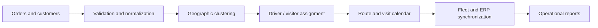
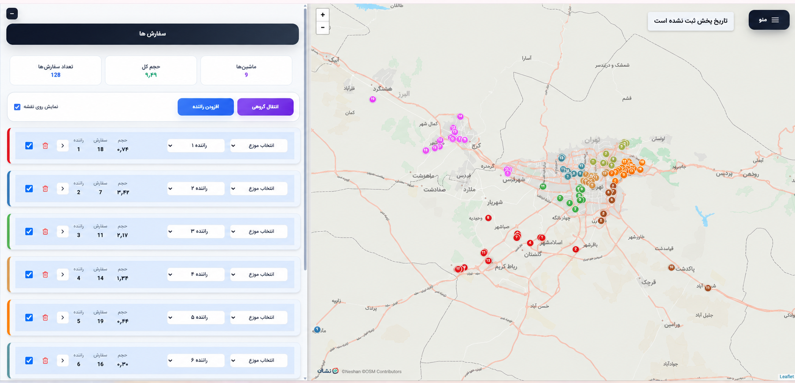
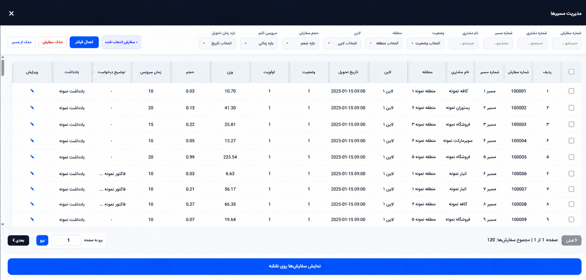
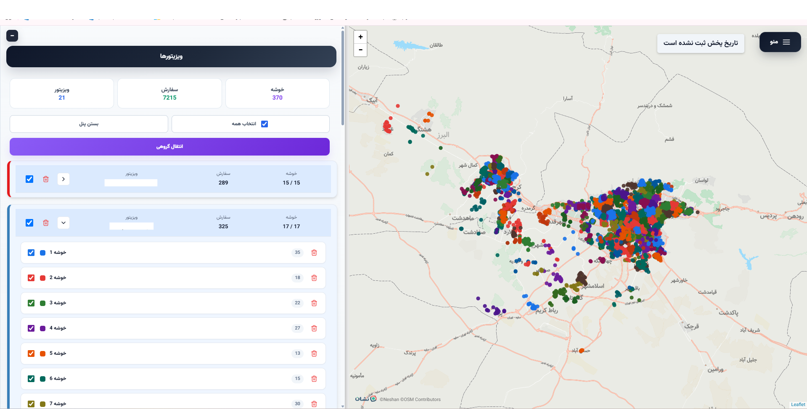
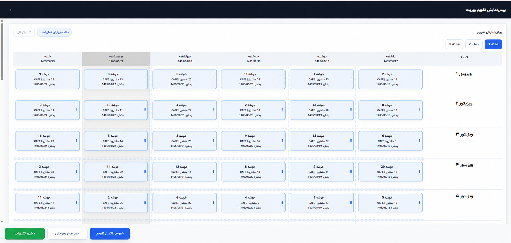
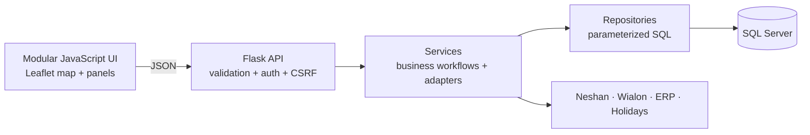

# Map8 — Logistics & Field Visit Planning Platform

[نسخه فارسی](README.md)

Map8 is an operational web platform that turns order and customer data into geographic clusters, executable routes, fleet assignments, and editable field-visit schedules.

**Developer:** Melina Maghferat

**My role:** full-stack development across the Flask API, SQL Server persistence, modular JavaScript UI, Leaflet map workflows, planning algorithms, external integrations, and Selenium-based ERP automation.

## The operational problem

Order intake, driver assignment, route planning, field visits, fleet synchronization, and ERP registration were separate operational steps. Map8 connects them in one map-centered workflow:

## What I implemented

| Area | My implementation |
|---|---|
| Backend | Domain-oriented Flask endpoints, request validation, consistent JSON responses, service/repository boundaries and centralized error handling |
| SQL Server | Parameterized repositories, multi-step transactions, staging tables, `fast_executemany`, `MERGE` upserts, pagination and tenant-scoped access |
| Frontend | Modular JavaScript panels, `fetch`/`async` request flows, CSRF-aware retries, loading/error states and synchronized map/table state |
| Geospatial planning | Capacity-aware clustering, Haversine distance, cluster refinement, customer reassignment and nearest-neighbor stop ordering |
| Visit scheduling | Multi-week workday generation, holiday handling, drag-and-drop moves, undo/cancel snapshots and dependent delivery-date recalculation |
| Map UI | Leaflet layers for orders, customers, clusters, drivers, visitors, routes and numbered stops |
| Integrations | Server-side adapters for Neshan, Wialon, official holiday data and data-warehouse workflows |
| ERP automation | Selenium WebDriver worker with explicit waits, form interaction, per-item execution results and guaranteed cleanup |
| Security and reliability | Session authentication, PBKDF2, CSRF, RBAC, tenant isolation, login throttling, activity logging, timeouts and transactional rollback |
| Modularization | Incremental extraction of frontend modules and backend route/service/repository layers while preserving operational behavior |

## Product evidence

### Fleet assignment and route construction

I implemented the assignment panel, selection state, map-layer synchronization, driver/vehicle workflow and route preparation used in this screen.

### Route and order management

This workflow combines server-backed filtering, pagination, bulk actions, route/order relationships and transactional persistence.

### Capacity-aware visit clustering

Customer points are grouped geographically under operational capacity rules, remain manually adjustable, and stay synchronized with the map and visitor panels.

### Editable visit calendar

The calendar supports multi-week workday generation, holiday rules, visit moves, undo/cancel, and recalculation of dependent visit and delivery dates.

## Key engineering decisions

| Challenge | Implemented approach |
|---|---|
| Consistent multi-table saves | Explicit transaction boundaries for route headers, ordered stops, assignments and dates |
| High-volume operational data | Database-side filtering/pagination, staging tables and batch insertion |
| Provider credentials | Same-origin Flask adapters; third-party credentials remain on the server |
| Editable calendar state | Immutable snapshots and deterministic recalculation after each move |
| Unstable ERP workflow | Controlled Selenium worker with explicit waits and structured item-level results |
| Large legacy codebase | Staged modular migration with behavior-parity checks |

## Architecture

## Selected implementation

The [`examples/`](examples/README.md) directory presents one connected route-planning flow rather than unrelated snippets:

| Component | System behavior shown |
|---|---|
| [Flask route](examples/backend/api.py) | Validation, tenant context, repository boundary and status codes |
| [SQL Server repository](examples/backend/sqlserver_repository.py) | Transaction, staging table, batch insert and `MERGE` |
| [Async API client](examples/frontend/api-client.js) | CSRF refresh, timeout, cancellation and normalized errors |
| [Calendar state](examples/frontend/editable-calendar.js) | Move validation, snapshots, undo and date recalculation |
| [Planning algorithms](examples/algorithms/geospatial.py) | Haversine, capacity allocation and stop sequencing |
| [ERP worker](examples/automation/erp_clicker.py) | Explicit waits, grouped submission, results and cleanup |
| [Tests](examples/tests) | Deterministic planning and calendar tests |

## Documentation

- [Architecture](docs/ARCHITECTURE.md)
- [API and integration map](docs/API_INTEGRATIONS.md)
- [Feature inventory](docs/FEATURES.md)
- [Technical deep dive](docs/TECHNICAL_DEEP_DIVE.md)
- [Screenshot gallery](screenshots/README.md)

## Technology

`Python` · `Flask` · `JavaScript` · `HTML/CSS` · `SQL Server` · `pyodbc` · `Leaflet` · `Selenium WebDriver` · `Pandas/NumPy` · `REST API` · `Wialon` · `Neshan`

## License

See [LICENSE.md](LICENSE.md).
