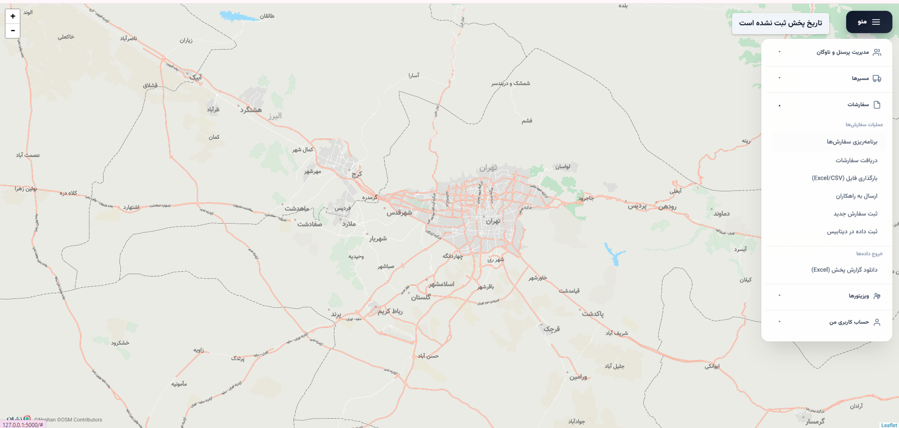
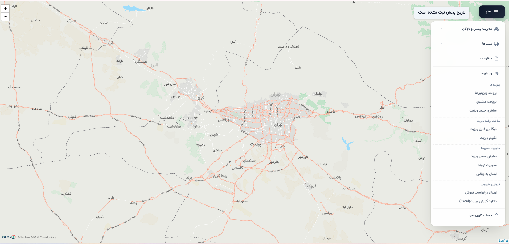
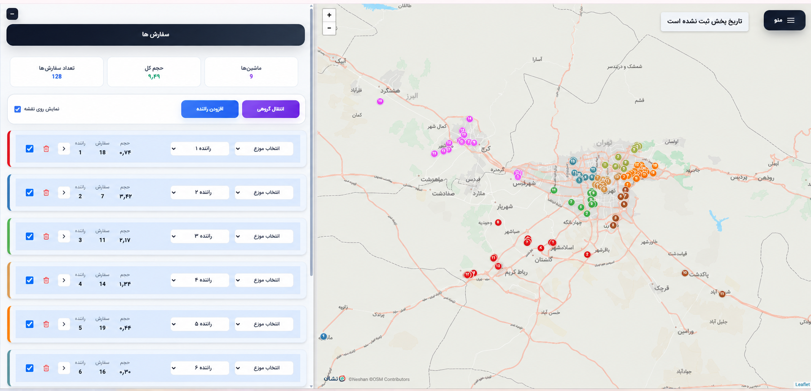
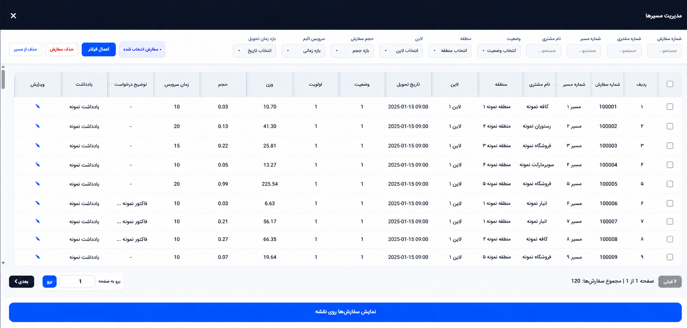
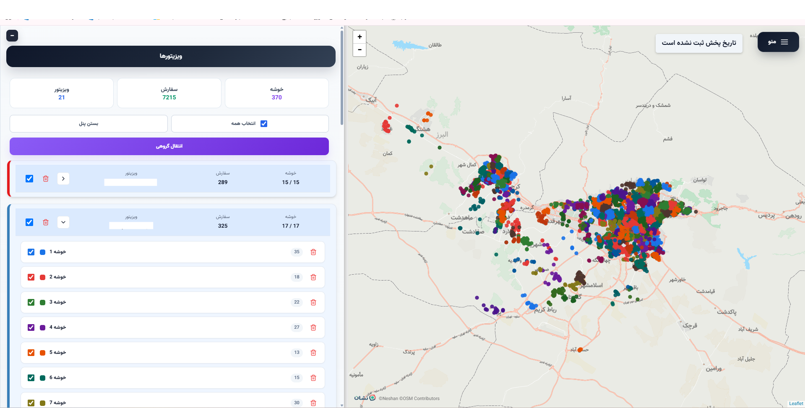
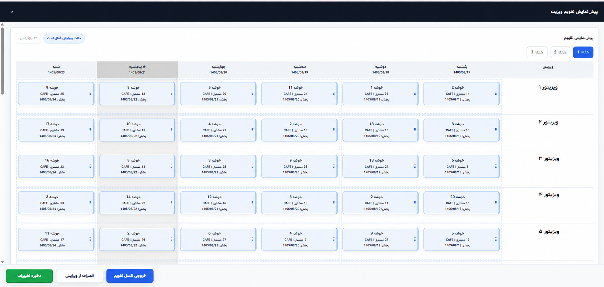
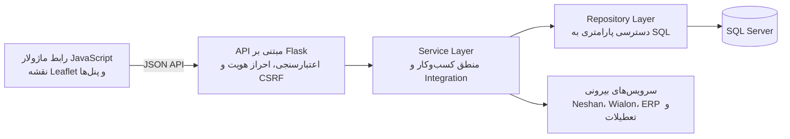

# Map8 — سامانه برنامه‌ریزی لجستیک و ویزیت میدانی

[English README](README.md)

Map8 یک سامانه عملیاتی مبتنی بر نقشه برای مدیریت سفارش، خوشه‌بندی جغرافیایی، برنامه‌ریزی مسیر، تخصیص ناوگان، تقویم ویزیت و گزارش‌های اجرایی است.

> این مخزن نسخه عمومی رزومه است و فقط مستندات و تصاویر تأییدشده محصول را شامل می‌شود. سورس اجرایی، کلیدها، اطلاعات مشتری، جزئیات دیتابیس و تنظیمات استقرار عمداً خصوصی نگه داشته شده‌اند.

## پروفایل مهندسی پروژه

| حوزه | توانمندی پیاده‌سازی‌شده |
|---|---|
| Backend | Flask Blueprint، طراحی REST API، تفکیک Route/Service/Repository، Validation و مدیریت خطا |
| SQL Server | Query پارامتری، Transaction چندمرحله‌ای، `MERGE`، Temporary Table، `fast_executemany` و Tenant Scope |
| Frontend Async | JavaScript ماژولار، `fetch`، `async/await`، `Promise.all`، `AbortController` و Retry آگاه از CSRF |
| الگوریتم | خوشه‌بندی ظرفیت‌محور، Haversine، اصلاح خوشه، Nearest Neighbor و زمان‌بندی روز کاری |
| امنیت | Session، PBKDF2، CSRF، RBAC، Tenant Isolation، Login Throttling و Activity Log |
| Integration | سرویس‌های Neshan، Wialon، تعطیلات رسمی، ERP و Data Warehouse |
| Browser Automation | کلیکر Selenium WebDriver برای ثبت کنترل‌شده تور در ERP، Explicit Wait، تعامل با فرم، Log و پاک‌سازی فایل موقت |
| پایداری | Transaction Boundary، Upsert قابل تکرار، Timeout، Fallback، Pagination و پردازش Batch |
| معماری | مهاجرت مرحله‌ای از برنامه بزرگ اولیه به ماژول‌های Frontend و لایه‌های Backend |

## تصاویر منتخب محصول

### عملیات نقشه و ناوبری دامنه‌ها

### تخصیص ناوگان و مدیریت مسیر

### برنامه‌ریزی جغرافیایی ویزیت

## نمای معماری

## APIهای بیرونی

| API داخلی برنامه | مقصد | کاربرد |
|---|---|---|
| `POST /tsp` | Neshan Trip API v3 | مرتب‌سازی جغرافیایی توقف‌ها |
| `POST /neshan_logistics` | Neshan Logistics API v5 | بهینه‌سازی سفارش‌ها بین خودروها |
| `POST /api/wialon_proxy` | Wialon Remote API | ایجاد و به‌روزرسانی سفارش و مسیر ناوگان |
| `GET /api/iran_holidays` | `time.ir/event-year` | محاسبه روزهای کاری تقویم ویزیت |
| `POST /rahkaran/send_tours` | Selenium WebDriver → فرم خصوصی ERP | ثبت کنترل‌شده اطلاعات تور با اتوماسیون مرورگر |
| `POST /sale_request/send` | گردش‌کار فروش | ارسال درخواست فروش اعتبارسنجی‌شده |
| `POST /api/import_pending_requests_from_dw` | Data Warehouse داخلی | دریافت و نرمال‌سازی درخواست‌ها |

فهرست کامل‌تر Endpointها و جریان داده در [API & Integrations](docs/API_INTEGRATIONS.md) آمده است.

## فعالیت‌های فنی انجام‌شده

- تفکیک تدریجی برنامه بزرگ اولیه به ماژول‌های Frontend و لایه‌های Backend
- پیاده‌سازی خوشه‌بندی ظرفیت‌محور و بازتخصیص جغرافیایی سفارش‌ها
- نمایش راننده، سفارش، ویزیتور، خوشه و توقف مسیر روی نقشه
- ذخیره تراکنشی Route، Tour، Customer و Assignmentها
- تقویم ویزیت قابل ویرایش همراه Undo، Cancel و محاسبه مجدد تاریخ‌های وابسته
- Integration سمت سرور بدون نمایش Token سرویس‌ها در مرورگر
- پیاده‌سازی کلیکر Selenium برای ورود به ERP، تکمیل فرم تور، ثبت رکوردها و بازگرداندن Log اجرای هر مورد
- Tenant scoping، Session، CSRF، هش رمز عبور و Activity Log
- جدول‌های حجیم، جست‌وجو، فیلتر، صفحه‌بندی، عملیات گروهی و خروجی Excel
- حفظ سازگاری رفتاری حین مهاجرت مرحله‌ای به معماری ماژولار

شرح فنی سطح پیاده‌سازی در [Technical Deep Dive](docs/TECHNICAL_DEEP_DIVE.md) آمده است.

## تکنولوژی‌ها

`Python` · `Flask` · `JavaScript` · `HTML/CSS` · `SQL Server` · `pyodbc` · `Leaflet` · `Selenium WebDriver` · `Pandas/NumPy` · `REST API` · `Wialon` · `Neshan`

## وضعیت سورس

سورس کامل محصول در مخزن خصوصی نگهداری می‌شود و در صورت نیاز می‌تواند در جلسه فنی یا محیط کنترل‌شده بررسی شود.

این مخزن متن‌باز نیست. شرایط استفاده در [LICENSE.md](LICENSE.md) آمده است.

## نمونه‌کدهای عمومی

پوشه [`examples/`](examples/README.md) شامل نمونه‌های مستقل و بازنویسی‌شده برای نمایش مهارت‌های فنی پروژه است: REST API با Flask، تراکنش و `MERGE` در SQL Server، ارتباط `fetch/async` همراه CSRF و timeout، مدیریت state تقویم قابل‌ویرایش، الگوریتم‌های جغرافیایی، Selenium WebDriver و تست واحد.

تمام endpointها، نام جدول‌ها، selectorها و داده‌های این پوشه ساختگی هستند و هیچ کدی از نسخه تولیدی در آن کپی نشده است.
