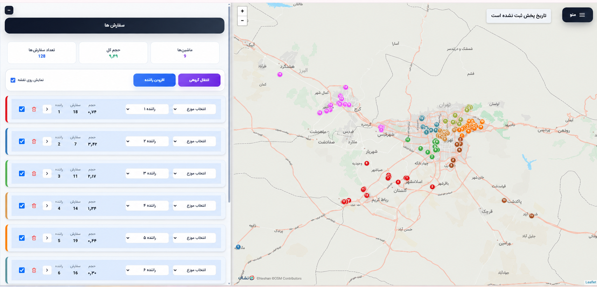
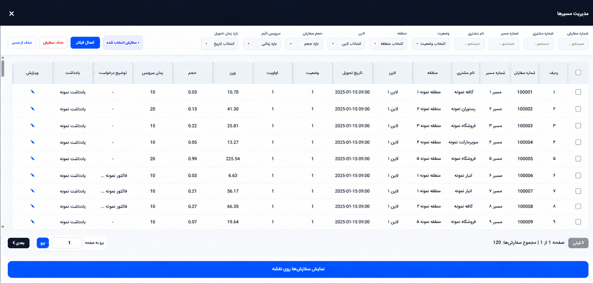
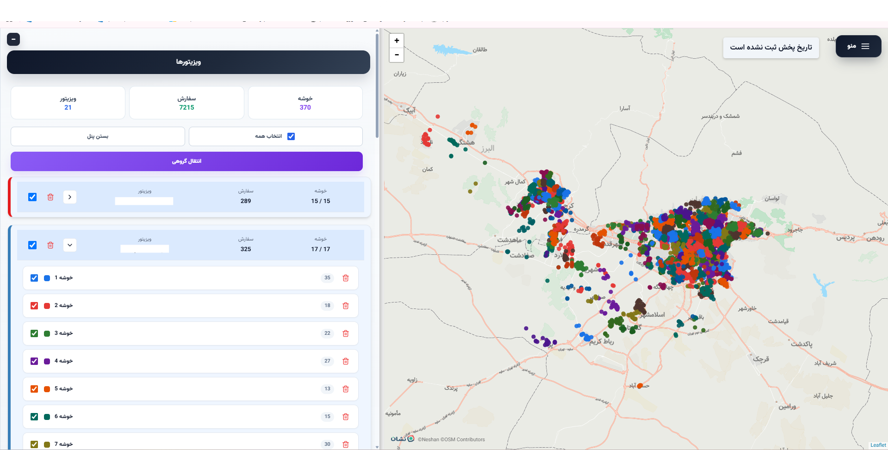
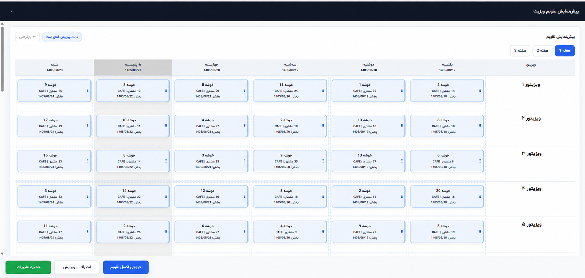
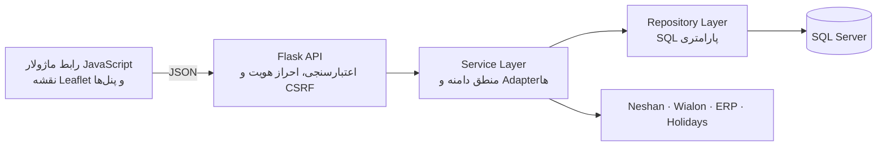

# Map8 — سامانه برنامه‌ریزی لجستیک و ویزیت میدانی

[English version](README.en.md)

Map8 یک سامانه وب عملیاتی است که داده‌های سفارش و مشتری را به خوشه‌های جغرافیایی، مسیرهای اجرایی، تخصیص ناوگان و برنامه ویزیت قابل‌ویرایش تبدیل می‌کند.

**توسعه‌دهنده:** ملینا مغفرت

**نقش من در پروژه:** توسعه فول‌استک بخش‌های Backend، پایگاه داده SQL Server، رابط ماژولار JavaScript، نقشه Leaflet، الگوریتم‌های برنامه‌ریزی، اتصال سرویس‌های بیرونی و اتوماسیون ERP با Selenium.

## مسئله‌ای که سیستم حل می‌کند

دریافت سفارش، تخصیص راننده، برنامه‌ریزی مسیر، ویزیت مشتری، همگام‌سازی ناوگان و ثبت اطلاعات در ERP فرایندهای جدا از هم بودند. Map8 این مراحل را در یک جریان کاری نقشه‌محور به هم متصل می‌کند:

## بخش‌هایی که من پیاده‌سازی کردم

| حوزه | پیاده‌سازی انجام‌شده |
|---|---|
| Backend | Endpointهای دامنه‌محور Flask، اعتبارسنجی ورودی، پاسخ‌های JSON یکپارچه، تفکیک Route/Service/Repository و مدیریت خطا |
| SQL Server | Query پارامتری، Transaction چندمرحله‌ای، Staging Table، `fast_executemany`، Upsert با `MERGE`، صفحه‌بندی و Tenant Scope |
| Frontend | پنل‌های ماژولار JavaScript، جریان‌های `fetch` و `async/await`، Retry آگاه از CSRF، وضعیت Loading/Error و همگام‌سازی نقشه و جدول |
| برنامه‌ریزی جغرافیایی | خوشه‌بندی ظرفیت‌محور، فاصله Haversine، اصلاح خوشه، انتقال مشتری و مرتب‌سازی توقف‌ها با Nearest Neighbor |
| تقویم ویزیت | تولید تقویم چند‌هفته‌ای، اعمال تعطیلات، جابه‌جایی ویزیت، Undo/Cancel و محاسبه مجدد تاریخ‌های وابسته |
| رابط نقشه | لایه‌های Leaflet برای سفارش، مشتری، خوشه، راننده، ویزیتور، مسیر و توقف‌های شماره‌گذاری‌شده |
| Integration | اتصال سمت سرور به Neshan، Wialon، سرویس تعطیلات رسمی و جریان‌های Data Warehouse |
| اتوماسیون ERP | Selenium WebDriver همراه Explicit Wait، تکمیل فرم، نتیجه اجرای هر مورد و پاک‌سازی تضمین‌شده منابع |
| امنیت و پایداری | Session، PBKDF2، CSRF، RBAC، Tenant Isolation، Login Throttling، Activity Log، Timeout و Rollback |
| معماری | استخراج مرحله‌ای ماژول‌های Frontend و لایه‌های Backend از برنامه بزرگ اولیه با حفظ رفتار عملیاتی |

## شواهد محصول

### تخصیص ناوگان و ساخت مسیر

در این بخش پنل تخصیص، وضعیت انتخاب‌ها، همگام‌سازی لیست و نقشه، گردش‌کار راننده/خودرو و آماده‌سازی مسیر را پیاده‌سازی کردم.

### مدیریت مسیر و سفارش

این جریان شامل فیلتر و صفحه‌بندی سمت سرور، عملیات گروهی، ارتباط سفارش با مسیر و ذخیره تراکنشی اطلاعات است.

### خوشه‌بندی ظرفیت‌محور ویزیت

مشتریان با درنظرگرفتن موقعیت جغرافیایی و محدودیت ظرفیت گروه‌بندی می‌شوند؛ خوشه‌ها قابل اصلاح دستی‌اند و وضعیت آن‌ها با نقشه و پنل ویزیتور همگام می‌ماند.

### تقویم ویزیت قابل‌ویرایش

تقویم از روزهای کاری و چرخه‌های ویزیت ساخته می‌شود و از جابه‌جایی، Undo، Cancel و محاسبه مجدد تاریخ ویزیت و تحویل پشتیبانی می‌کند.

## چالش‌های فنی و راه‌حل‌ها

| چالش | راه‌حل پیاده‌سازی‌شده |
|---|---|
| ذخیره سازگار چند جدول مرتبط | Transaction صریح برای Route، Stop، Assignment و تاریخ‌ها |
| حجم بالای داده‌های عملیاتی | فیلتر و Pagination در دیتابیس، Staging Table و درج Batch |
| محافظت از اطلاعات سرویس‌ها | Adapterهای same-origin در Flask و نگهداری Credentialها در سرور |
| ویرایش تقویم بدون از دست‌رفتن وضعیت | Snapshotهای قابل بازگشت و محاسبه قطعی تاریخ‌ها پس از هر جابه‌جایی |
| نبود API پایدار برای ERP | Worker کنترل‌شده Selenium با Explicit Wait و نتیجه ساختاریافته برای هر رکورد |
| نگهداری برنامه بزرگ اولیه | مهاجرت مرحله‌ای به معماری ماژولار همراه کنترل برابری رفتار |

## معماری

## بخش‌های منتخب پیاده‌سازی

پوشه [`examples/`](examples/README.md) یک جریان متصل از ثبت Route Plan تا ذخیره در SQL Server و پردازش تقویم و ERP را نمایش می‌دهد:

| مؤلفه | رفتار فنی قابل بررسی |
|---|---|
| [Flask Route](examples/backend/api.py) | اعتبارسنجی، Tenant Context، مرز Repository و Status Code |
| [SQL Server Repository](examples/backend/sqlserver_repository.py) | Transaction، Staging Table، Batch Insert و `MERGE` |
| [Async API Client](examples/frontend/api-client.js) | CSRF Refresh، Timeout، Cancellation و خطاهای نرمال‌شده |
| [Calendar State](examples/frontend/editable-calendar.js) | اعتبارسنجی جابه‌جایی، Snapshot، Undo و محاسبه تاریخ |
| [Planning Algorithms](examples/algorithms/geospatial.py) | Haversine، تخصیص ظرفیت‌محور و ترتیب توقف‌ها |
| [ERP Worker](examples/automation/erp_clicker.py) | Explicit Wait، ثبت گروهی، نتیجه هر مورد و Cleanup |
| [Tests](examples/tests) | تست قطعی رفتار الگوریتم و تقویم |

## مستندات فنی

- [معماری](docs/ARCHITECTURE.md)
- [نقشه API و Integrationها](docs/API_INTEGRATIONS.md)
- [فهرست قابلیت‌ها](docs/FEATURES.md)
- [شرح فنی پیاده‌سازی](docs/TECHNICAL_DEEP_DIVE.md)
- [گالری تصاویر](screenshots/README.md)

## تکنولوژی‌ها

`Python` · `Flask` · `JavaScript` · `HTML/CSS` · `SQL Server` · `pyodbc` · `Leaflet` · `Selenium WebDriver` · `Pandas/NumPy` · `REST API` · `Wialon` · `Neshan`

## مجوز

شرایط استفاده در [LICENSE.md](LICENSE.md) آمده است.
