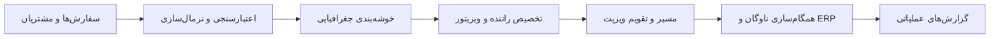
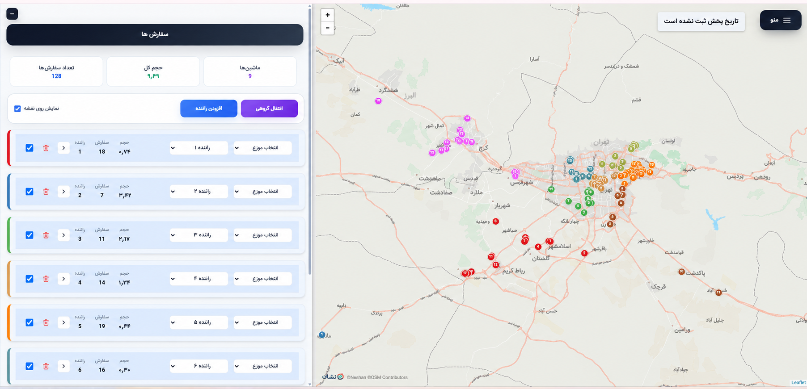
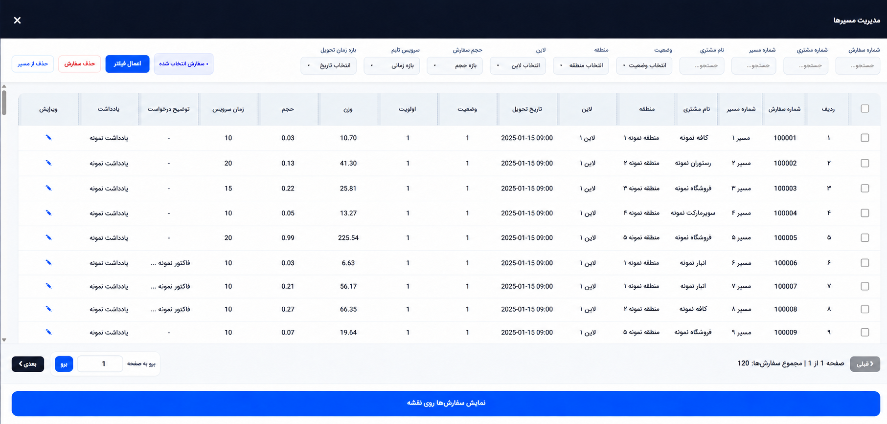
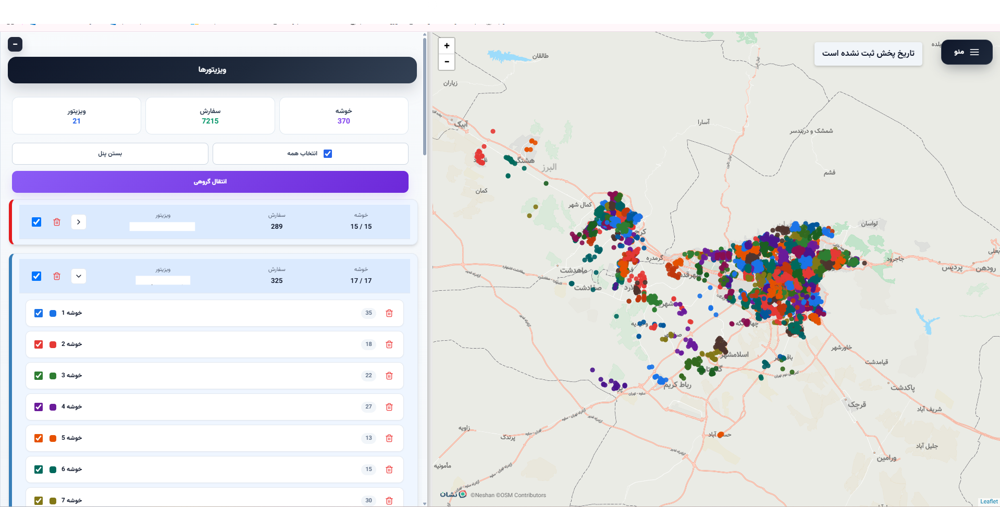
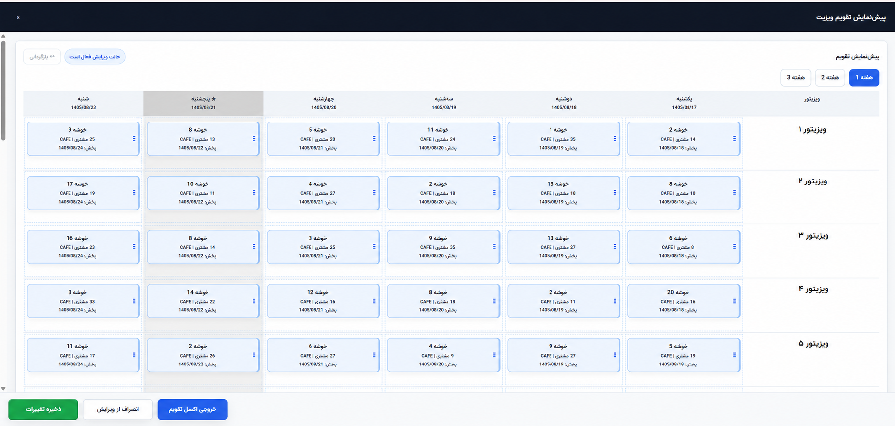
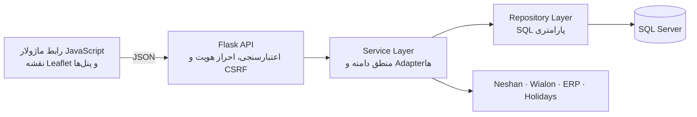

# Map8 — سامانه برنامه‌ریزی لجستیک و ویزیت میدانی

[English version](README.en.md)

Map8 یک سامانه وب عملیاتی است که داده‌های سفارش و مشتری را به خوشه‌های جغرافیایی، مسیرهای اجرایی، تخصیص ناوگان و برنامه ویزیت قابل‌ویرایش تبدیل می‌کند.

**توسعه‌دهنده:** ملینا مغفرت

**نقش من در پروژه:** توسعه فول‌استک بخش‌های Backend، پایگاه داده SQL Server، رابط ماژولار JavaScript، نقشه Leaflet، الگوریتم‌های برنامه‌ریزی، اتصال سرویس‌های بیرونی و اتوماسیون ERP با Selenium.

## مسئله‌ای که سیستم حل می‌کند

دریافت سفارش، تخصیص راننده، برنامه‌ریزی مسیر، ویزیت مشتری، همگام‌سازی ناوگان و ثبت اطلاعات در ERP فرایندهای جدا از هم بودند. Map8 این مراحل را در یک جریان کاری نقشه‌محور به هم متصل می‌کند:

## بخش‌هایی که من پیاده‌سازی کردم

<table dir="rtl">
  <thead>
    <tr>
      <th align="right" dir="rtl">حوزه</th>
      <th align="right" dir="rtl">پیاده‌سازی انجام‌شده</th>
    </tr>
  </thead>
  <tbody>
    <tr><td align="right" dir="rtl">Backend</td><td align="right" dir="rtl">Endpointهای دامنه‌محور Flask، اعتبارسنجی ورودی، پاسخ‌های JSON یکپارچه، تفکیک Route / Service / Repository و مدیریت خطا</td></tr>
    <tr><td align="right" dir="rtl">SQL Server</td><td align="right" dir="rtl">Query پارامتری، Transaction چندمرحله‌ای، Staging Table، <code>fast_executemany</code>، Upsert با <code>MERGE</code>، صفحه‌بندی و Tenant Scope</td></tr>
    <tr><td align="right" dir="rtl">Frontend</td><td align="right" dir="rtl">پنل‌های ماژولار JavaScript، جریان‌های <code>fetch</code> و <code>async/await</code>، Retry آگاه از CSRF، وضعیت Loading / Error و همگام‌سازی نقشه و جدول</td></tr>
    <tr><td align="right" dir="rtl">برنامه‌ریزی جغرافیایی</td><td align="right" dir="rtl">خوشه‌بندی ظرفیت‌محور، فاصله Haversine، اصلاح خوشه، انتقال مشتری و مرتب‌سازی توقف‌ها با Nearest Neighbor</td></tr>
    <tr><td align="right" dir="rtl">تقویم ویزیت</td><td align="right" dir="rtl">تولید تقویم چند‌هفته‌ای، اعمال تعطیلات، جابه‌جایی ویزیت، Undo / Cancel و محاسبه مجدد تاریخ‌های وابسته</td></tr>
    <tr><td align="right" dir="rtl">رابط نقشه</td><td align="right" dir="rtl">لایه‌های Leaflet برای سفارش، مشتری، خوشه، راننده، ویزیتور، مسیر و توقف‌های شماره‌گذاری‌شده</td></tr>
    <tr><td align="right" dir="rtl">Integration</td><td align="right" dir="rtl">اتصال سمت سرور به Neshan، Wialon، سرویس تعطیلات رسمی و جریان‌های Data Warehouse</td></tr>
    <tr><td align="right" dir="rtl">اتوماسیون ERP</td><td align="right" dir="rtl">Selenium WebDriver همراه Explicit Wait، تکمیل فرم، نتیجه اجرای هر مورد و پاک‌سازی تضمین‌شده منابع</td></tr>
    <tr><td align="right" dir="rtl">امنیت و پایداری</td><td align="right" dir="rtl">Session، PBKDF2، CSRF، RBAC، Tenant Isolation، Login Throttling، Activity Log، Timeout و Rollback</td></tr>
    <tr><td align="right" dir="rtl">معماری</td><td align="right" dir="rtl">استخراج مرحله‌ای ماژول‌های Frontend و لایه‌های Backend از برنامه بزرگ اولیه با حفظ رفتار عملیاتی</td></tr>
  </tbody>
</table>

## شواهد محصول

### تخصیص ناوگان و ساخت مسیر

در این بخش پنل تخصیص، وضعیت انتخاب‌ها، همگام‌سازی لیست و نقشه، گردش‌کار راننده/خودرو و آماده‌سازی مسیر را پیاده‌سازی کردم.

### مدیریت مسیر و سفارش

این جریان شامل فیلتر و صفحه‌بندی سمت سرور، عملیات گروهی، ارتباط سفارش با مسیر و ذخیره تراکنشی اطلاعات است.

### خوشه‌بندی ظرفیت‌محور ویزیت

مشتریان با درنظرگرفتن موقعیت جغرافیایی و محدودیت ظرفیت گروه‌بندی می‌شوند؛ خوشه‌ها قابل اصلاح دستی‌اند و وضعیت آن‌ها با نقشه و پنل ویزیتور همگام می‌ماند.

### تقویم ویزیت قابل‌ویرایش

تقویم از روزهای کاری و چرخه‌های ویزیت ساخته می‌شود و از جابه‌جایی، Undo، Cancel و محاسبه مجدد تاریخ ویزیت و تحویل پشتیبانی می‌کند.

## چالش‌های فنی و راه‌حل‌ها

<table dir="rtl">
  <thead>
    <tr>
      <th align="right" dir="rtl">چالش</th>
      <th align="right" dir="rtl">راه‌حل پیاده‌سازی‌شده</th>
    </tr>
  </thead>
  <tbody>
    <tr><td align="right" dir="rtl">ذخیره سازگار چند جدول مرتبط</td><td align="right" dir="rtl">Transaction صریح برای Route، Stop، Assignment و تاریخ‌ها</td></tr>
    <tr><td align="right" dir="rtl">حجم بالای داده‌های عملیاتی</td><td align="right" dir="rtl">فیلتر و Pagination در دیتابیس، Staging Table و درج Batch</td></tr>
    <tr><td align="right" dir="rtl">محافظت از اطلاعات سرویس‌ها</td><td align="right" dir="rtl">Adapterهای same-origin در Flask و نگهداری Credentialها در سرور</td></tr>
    <tr><td align="right" dir="rtl">ویرایش تقویم بدون از دست‌رفتن وضعیت</td><td align="right" dir="rtl">Snapshotهای قابل بازگشت و محاسبه قطعی تاریخ‌ها پس از هر جابه‌جایی</td></tr>
    <tr><td align="right" dir="rtl">نبود API پایدار برای ERP</td><td align="right" dir="rtl">Worker کنترل‌شده Selenium با Explicit Wait و نتیجه ساختاریافته برای هر رکورد</td></tr>
    <tr><td align="right" dir="rtl">نگهداری برنامه بزرگ اولیه</td><td align="right" dir="rtl">مهاجرت مرحله‌ای به معماری ماژولار همراه کنترل برابری رفتار</td></tr>
  </tbody>
</table>

## معماری

## بخش‌های منتخب پیاده‌سازی

پوشه [`examples/`](examples/README.md) یک جریان متصل از ثبت Route Plan تا ذخیره در SQL Server و پردازش تقویم و ERP را نمایش می‌دهد:

<table dir="rtl">
  <thead>
    <tr>
      <th align="right" dir="rtl">مؤلفه</th>
      <th align="right" dir="rtl">رفتار فنی قابل بررسی</th>
    </tr>
  </thead>
  <tbody>
    <tr><td align="right" dir="rtl"><a href="examples/backend/api.py">Flask Route</a></td><td align="right" dir="rtl">اعتبارسنجی، Tenant Context، مرز Repository و Status Code</td></tr>
    <tr><td align="right" dir="rtl"><a href="examples/backend/sqlserver_repository.py">SQL Server Repository</a></td><td align="right" dir="rtl">Transaction، Staging Table، Batch Insert و <code>MERGE</code></td></tr>
    <tr><td align="right" dir="rtl"><a href="examples/frontend/api-client.js">Async API Client</a></td><td align="right" dir="rtl">CSRF Refresh، Timeout، Cancellation و خطاهای نرمال‌شده</td></tr>
    <tr><td align="right" dir="rtl"><a href="examples/frontend/editable-calendar.js">Calendar State</a></td><td align="right" dir="rtl">اعتبارسنجی جابه‌جایی، Snapshot، Undo و محاسبه تاریخ</td></tr>
    <tr><td align="right" dir="rtl"><a href="examples/algorithms/geospatial.py">Planning Algorithms</a></td><td align="right" dir="rtl">Haversine، تخصیص ظرفیت‌محور و ترتیب توقف‌ها</td></tr>
    <tr><td align="right" dir="rtl"><a href="examples/automation/erp_clicker.py">ERP Worker</a></td><td align="right" dir="rtl">Explicit Wait، ثبت گروهی، نتیجه هر مورد و Cleanup</td></tr>
    <tr><td align="right" dir="rtl"><a href="examples/tests">Tests</a></td><td align="right" dir="rtl">تست قطعی رفتار الگوریتم و تقویم</td></tr>
  </tbody>
</table>

## مستندات فنی

<ul dir="rtl">
  <li align="right"><a href="docs/ARCHITECTURE.md">معماری</a></li>
  <li align="right"><a href="docs/API_INTEGRATIONS.md">نقشه API و Integrationها</a></li>
  <li align="right"><a href="docs/FEATURES.md">فهرست قابلیت‌ها</a></li>
  <li align="right"><a href="docs/TECHNICAL_DEEP_DIVE.md">شرح فنی پیاده‌سازی</a></li>
  <li align="right"><a href="screenshots/README.md">گالری تصاویر</a></li>
</ul>

## تکنولوژی‌ها

`Python` · `Flask` · `JavaScript` · `HTML/CSS` · `SQL Server` · `pyodbc` · `Leaflet` · `Selenium WebDriver` · `Pandas/NumPy` · `REST API` · `Wialon` · `Neshan`

## مجوز

شرایط استفاده در [LICENSE.md](LICENSE.md) آمده است.
