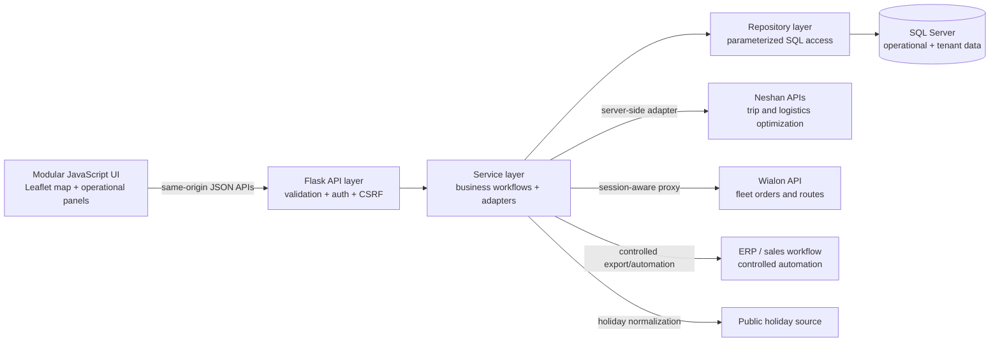

# Map8 — Logistics & Field Visit Planning Platform

[نسخه فارسی](README.fa.md)

Map8 is a production-oriented logistics and field-visit planning platform built around an interactive map. It brings order intake, geographic clustering, route planning, fleet assignment, visit scheduling, operational reporting, and external fleet integrations into one workflow.

## Engineering profile

| Area | Work demonstrated |
|---|---|
| Backend engineering | Flask blueprints, RESTful JSON endpoints, service/repository separation, validation, centralized error handling |
| SQL Server | Parameterized queries, multi-step transactions, `MERGE` upserts, temporary staging tables, `fast_executemany`, tenant-scoped data access |
| Asynchronous frontend | Modular JavaScript, `fetch`, `async/await`, `Promise.all`, `AbortController`, CSRF-aware request retries and UI state synchronization |
| Algorithms | Capacity-constrained geographic clustering, Haversine distance, cluster refinement, nearest-neighbor stop ordering, workday scheduling |
| Security | Session authentication, PBKDF2 password hashing, CSRF protection, RBAC, tenant isolation, login throttling and activity auditing |
| Integrations | Neshan routing/logistics APIs, Wialon Remote API, public holiday data, ERP automation and internal data-warehouse adapters |
| Browser automation | Selenium WebDriver for controlled ERP tour entry, explicit waits, form interaction, execution logs and temporary-file cleanup |
| Reliability | Transaction boundaries, idempotent `MERGE` flows, provider timeouts, fallbacks, pagination, bulk processing and parity tests |
| Architecture | Incremental migration from a large legacy application to frontend modules and backend route/service/repository layers |

## Selected product screens

The screenshots below are intentionally limited to approved product views. Operational credentials and infrastructure details are not included.

### Map-centered operations and domain navigation

### Fleet assignment and route management

### Geospatial visit planning

See [the screenshot guide](screenshots/README.md) before adding public images.

## Architecture at a glance

The application was progressively decomposed from a large legacy implementation into frontend modules and backend route/service/repository layers while preserving operational behavior.

## API and integration map

The browser communicates only with same-origin Flask endpoints. Credentials for third-party systems stay on the server.

| Application API | Method | Backend destination | Purpose |
|---|---:|---|---|
| `/tsp` | POST | Neshan Trip API v3 | Sequence a set of geographic stops |
| `/neshan_logistics` | POST | Neshan Logistics API v5 | Optimize jobs across vehicles |
| `/api/wialon_proxy` | POST | Wialon Remote API | Create/update fleet orders and routes through an allow-listed proxy |
| `/api/iran_holidays` | GET | `time.ir/event-year` | Normalize official Iranian holidays for visit-calendar generation |
| `/rahkaran/send_tours` | POST | Selenium WebDriver → private ERP form | Transfer approved tour data through controlled browser automation |
| `/sale_request/send` | POST | Sales workflow adapter | Submit validated sales requests |
| `/api/import_pending_requests_from_dw` | POST | Internal data warehouse adapter | Import and normalize pending operational requests |

Authentication, orders, visits, users, attendance, scheduling, and reporting APIs are documented in [API & Integrations](docs/API_INTEGRATIONS.md).

## Engineering work represented

- Refactored a large operational application toward modular frontend and layered backend boundaries
- Implemented capacity-aware clustering, geographic reassignment, and route ordering
- Built map rendering for drivers, visitors, clusters, orders, and route stops
- Designed transactional save flows for routes, tours, customers, and order assignments
- Added editable visit-calendar state with drag-and-drop, undo, cancellation, and dependent-date recalculation
- Added server-side integrations without exposing provider tokens to the browser
- Implemented a Selenium-based ERP automation worker to authenticate, populate tour forms, submit records, and return item-level execution logs
- Added tenant scoping, session authentication, CSRF validation, password hashing, and activity auditing
- Implemented high-volume tables, server-backed filtering, pagination, bulk actions, virtualized operational state, and report workflows
- Preserved legacy behavior during staged modular migration and parity verification

For implementation-level detail, see the [Technical Deep Dive](docs/TECHNICAL_DEEP_DIVE.md).

## Engineering samples

The [`examples/`](examples/README.md) directory demonstrates the core engineering patterns used across the platform.

| Sample | Demonstrates |
|---|---|
| [Flask API](examples/backend/api.py) | Request validation, service boundaries, tenant context, JSON errors and status codes |
| [SQL Server repository](examples/backend/sqlserver_repository.py) | Parameterized SQL, transaction scope, staging tables, `fast_executemany` and idempotent `MERGE` |
| [Async API client](examples/frontend/api-client.js) | `fetch`, `async/await`, CSRF refresh, timeout, cancellation and normalized errors |
| [Editable calendar state](examples/frontend/editable-calendar.js) | Immutable snapshots, move validation, undo and dependent-date recalculation |
| [Geospatial planning](examples/algorithms/geospatial.py) | Haversine distance, capacity-aware allocation and nearest-neighbor ordering |
| [Selenium worker](examples/automation/erp_clicker.py) | Explicit waits, environment configuration, structured logs and guaranteed cleanup |
| [Automated tests](examples/tests/test_geospatial.py) | Deterministic unit tests for distance, capacity and stop ordering |

## Technology

`Python` · `Flask` · `JavaScript` · `HTML/CSS` · `SQL Server` · `pyodbc` · `Leaflet` · `Selenium WebDriver` · `Pandas/NumPy` · `REST APIs` · `Wialon` · `Neshan`

## Documentation

- [Architecture](docs/ARCHITECTURE.md)
- [API & integrations](docs/API_INTEGRATIONS.md)
- [Feature and engineering inventory](docs/FEATURES.md)
- [Technical deep dive](docs/TECHNICAL_DEEP_DIVE.md)
- [Screenshot gallery](screenshots/README.md)

## License

This is a portfolio showcase, not an open-source distribution. See [LICENSE.md](LICENSE.md).
