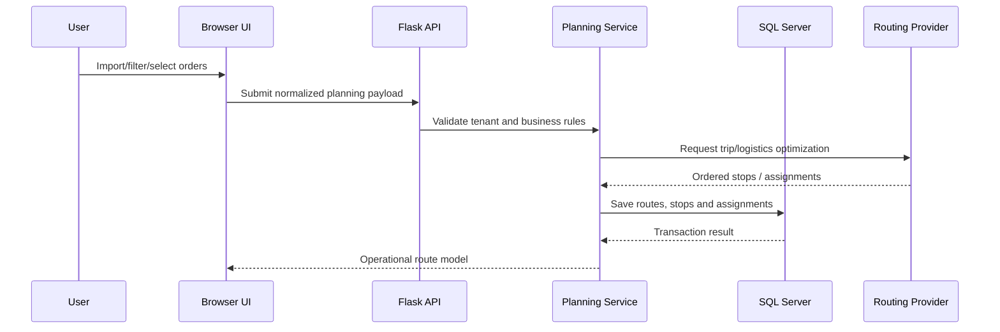
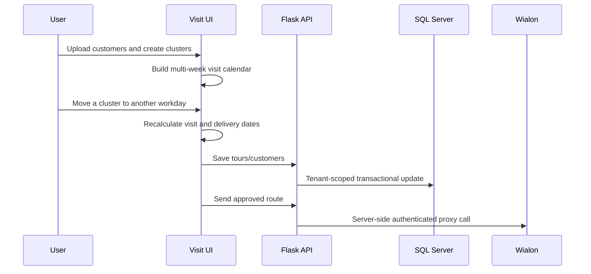
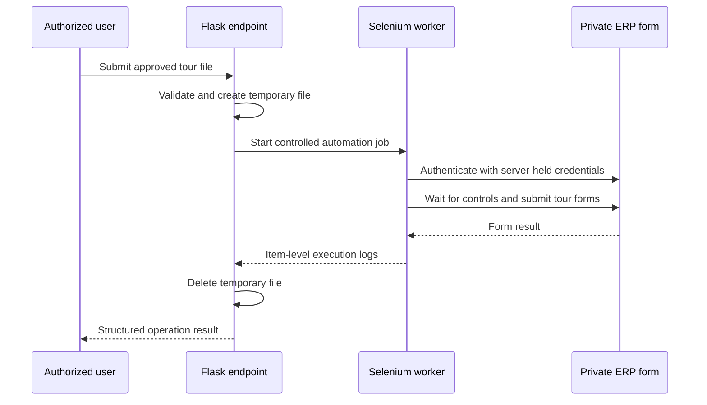

# Architecture

## Design goals

- Keep the map responsive while large operational panels are open.
- Isolate provider credentials from browser code.
- Preserve operational behavior during gradual modularization.
- Keep business workflows out of HTTP route handlers.
- Apply tenant scope and authorization consistently.
- Support bulk imports and exports without coupling UI code to database details.

## Frontend

The frontend is split into focused JavaScript modules for authentication, map bootstrap, orders, clustering, routing, drivers, users, visits, reporting, and API access.

Key responsibilities include:

- Leaflet layer lifecycle and viewport management
- Large table rendering, filters, pagination, and selection state
- Excel/CSV parsing and validation feedback
- Cluster, route, order, driver, and visitor visualization
- Editable visit-calendar state and dependent-date recalculation
- Same-origin API calls with CSRF and session handling

## Backend

The Flask backend follows an incremental layered structure:

```text
routes/        HTTP request validation and response shaping
services/      business workflows and external-provider adapters
repositories/ parameterized database operations
core/          configuration, security, tenant context, shared helpers
```

The migration was staged so existing production behavior could continue while responsibilities were extracted from the legacy implementation.

## Data flows

### Order planning



### Field-visit planning



## Security boundaries

- Third-party tokens remain in server environment variables.
- Browser integrations use restricted same-origin proxy endpoints.
- Mutating requests use authenticated sessions and CSRF validation.
- Database access is parameterized and tenant-scoped.
- Sensitive infrastructure identifiers are excluded from this portfolio repository.

## Selenium automation boundary

An ERP workflow without a suitable integration API was automated behind a backend endpoint using Selenium WebDriver. The worker consumes a validated temporary tour file, opens an authenticated browser session, waits explicitly for required controls, fills date and tour fields, submits the form, records item-level results, and closes the browser in a guaranteed cleanup path. Credentials and the private ERP address remain server-side and are not included in this repository.


