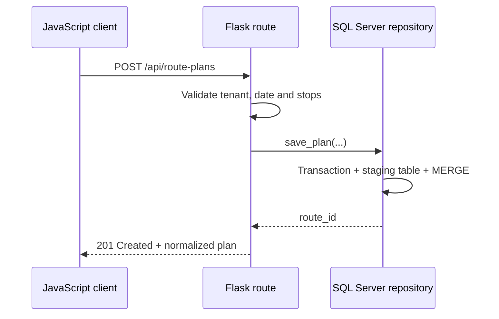

# Selected implementation

The files in this directory follow one connected operational flow: the browser submits a route plan, Flask validates the request, SQL Server persists the route and ordered stops transactionally, calendar state recalculates dependent dates, planning helpers order geographic stops, and the Selenium worker transfers approved tours to the ERP workflow.

## Request-to-persistence flow



## Implementation map

| Component | Responsibility |
|---|---|
| [`backend/api.py`](backend/api.py) | HTTP validation, tenant context, status codes and repository boundary |
| [`backend/sqlserver_repository.py`](backend/sqlserver_repository.py) | Transaction, staging table, `fast_executemany` and idempotent `MERGE` |
| [`frontend/api-client.js`](frontend/api-client.js) | Same-origin requests, CSRF refresh, cancellation, timeout and normalized errors |
| [`frontend/editable-calendar.js`](frontend/editable-calendar.js) | Calendar snapshots, move validation, undo and delivery-date recalculation |
| [`algorithms/geospatial.py`](algorithms/geospatial.py) | Haversine distance, capacity-aware allocation and nearest-neighbor ordering |
| [`automation/erp_clicker.py`](automation/erp_clicker.py) | Explicit waits, grouped tour submission, item-level results and cleanup |
| [`tests/`](tests) | Deterministic tests for planning and calendar behavior |

## Run the tests

Run the Python and JavaScript tests:

```bash
python -m unittest discover -s examples/tests -v
cd examples && npm test
```

Optional packages for the integration examples are listed in `requirements.txt`.

